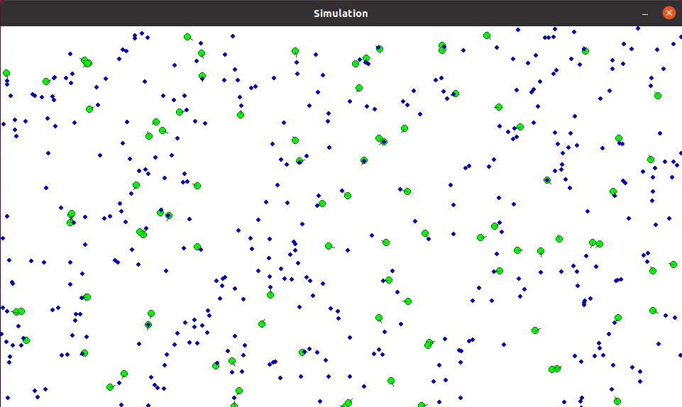
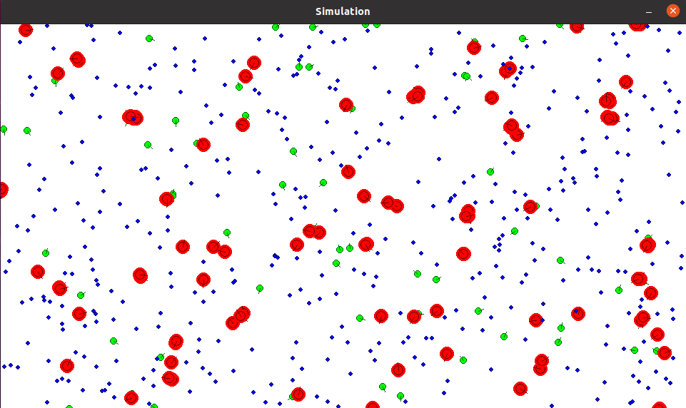
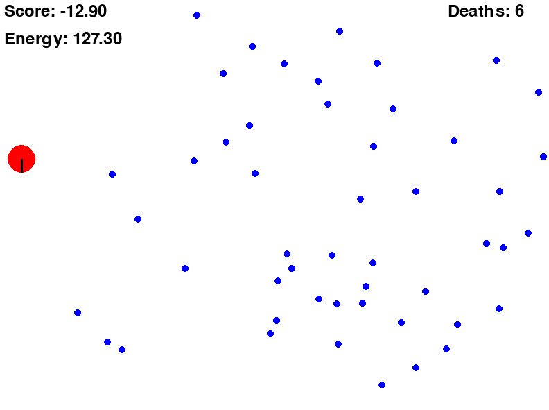

# evolving-simple-organisms
[](https://colab.research.google.com/drive/1yFYZgkbBtIFWZ6LVQ0an5vKQ654s3h-f?usp=sharing)

Colab: 

colab üzerinde çalıştırmak isteyenler için eğitim sonucunda gelen ağırlık dosyasını çalıştırabilir:

```
cd ~/evolving-simple-organisms/scripts/one-way-learning/colab

python test.py
```

start sminulation:

```
cd ~/evolving-simple-organisms/scripts/one-way-learning

python agent.py
```

new terminal:

`tensorboard --logdir=logs`

## REINFORCE experiments

The one-food baseline and multi-food scenario live in `scripts/REINFORCE`.

```bash
cd scripts/REINFORCE
python main.py --scenario scenarios/one_food.json
python main.py --scenario scenarios/multi_food.json
```

Each run writes checkpoints and TensorBoard events to `runs/<scenario>/<timestamp>/`.


for simulation photo:




update version:




Creating weights for an organism:


